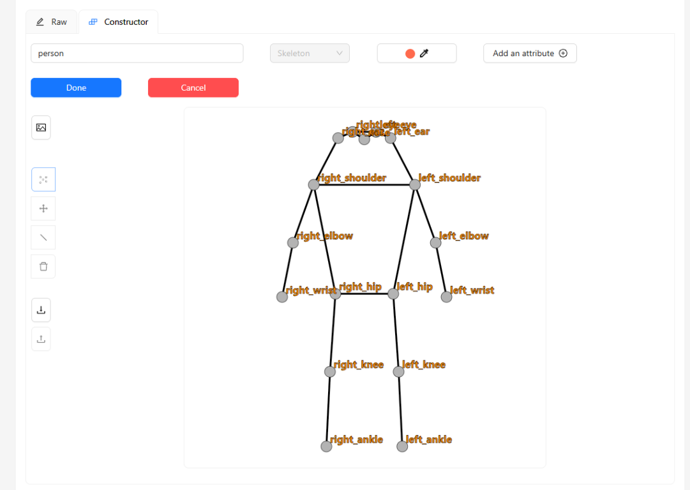
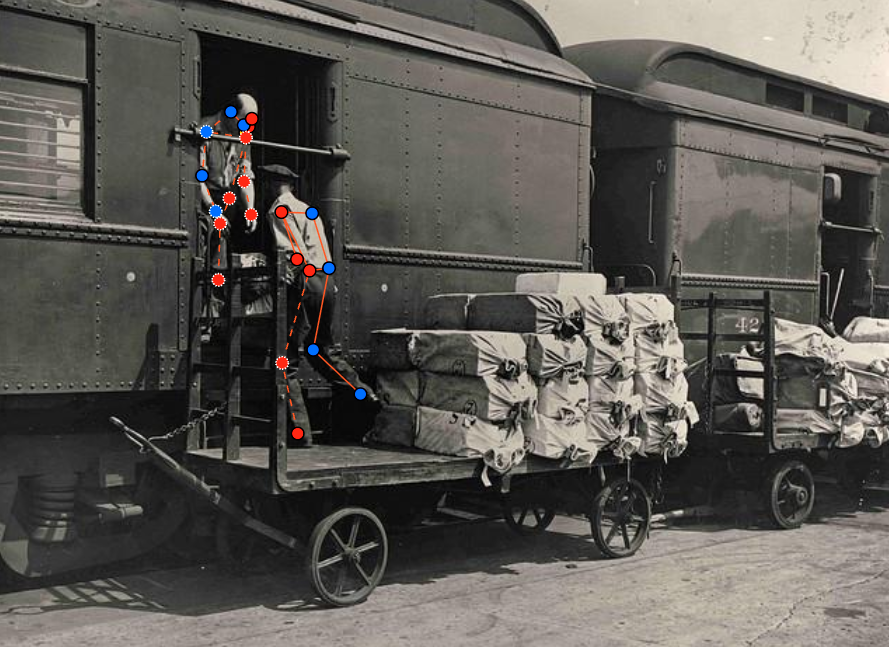
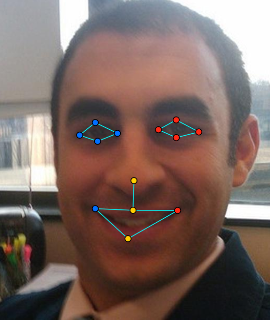
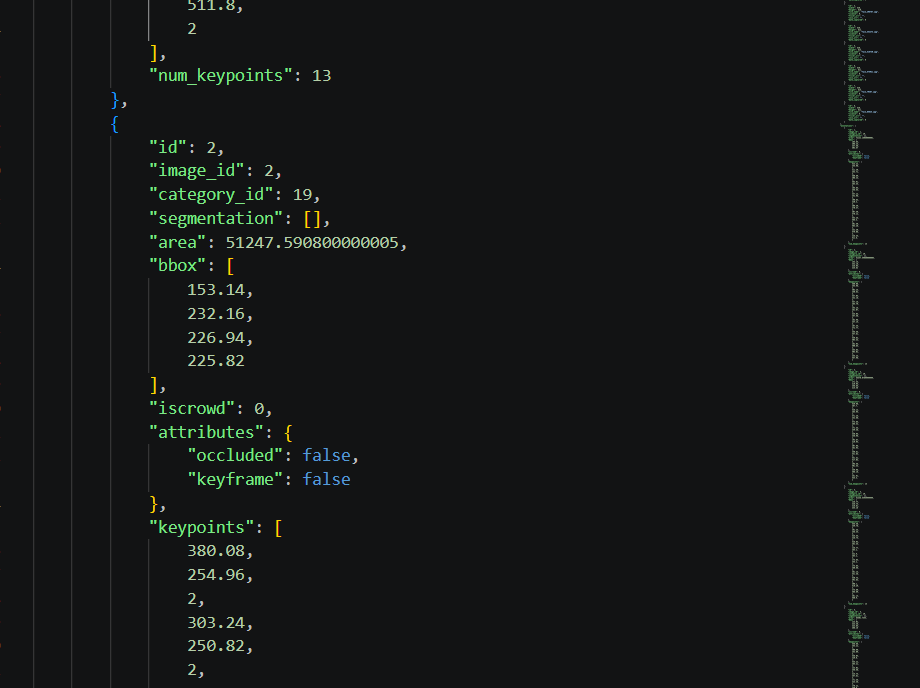
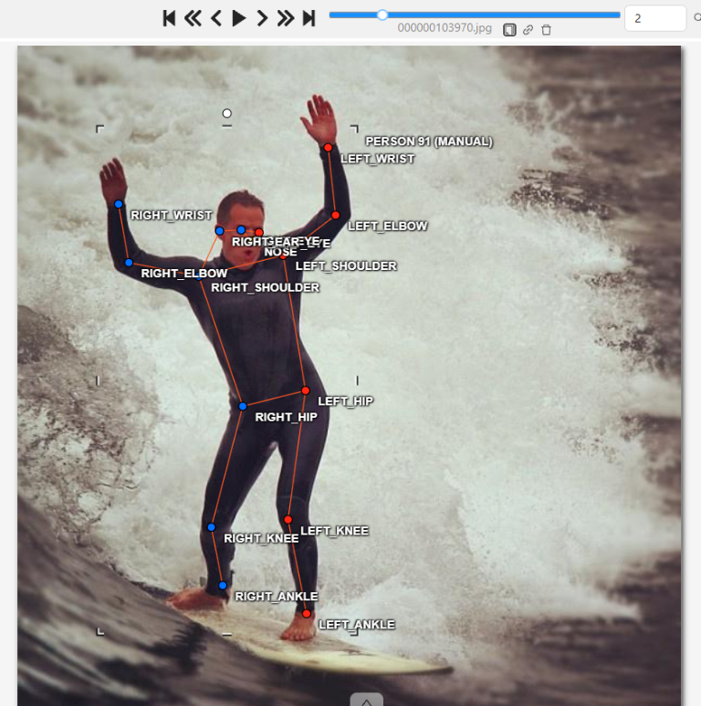
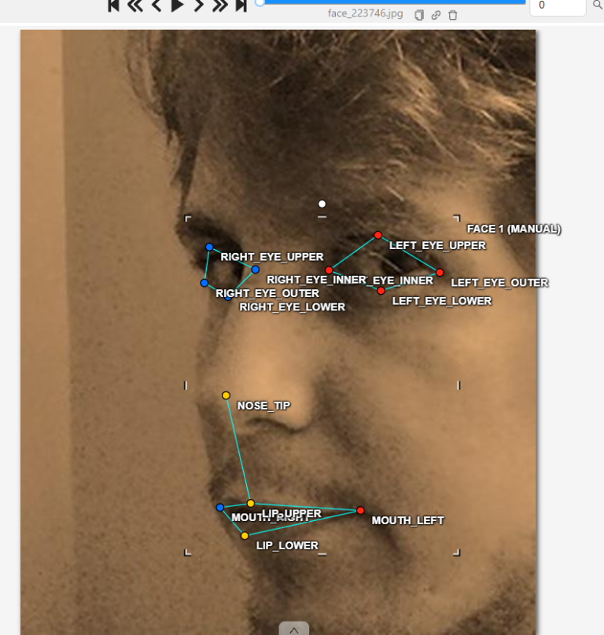

# Báo cáo cá nhân — HoXuanHung-2A202603062

## 0. Thông tin học viên

- Họ tên: Ho Xuan Hung
- MSSV: `2A202603062`
- Email: [26ai.hunghx@vinuni.edu.vn](mailto:26ai.hunghx@vinuni.edu.vn)
- Link repository: [GitHub repository](https://github.com/Hiung0703/K5-L2-DAY04-HoXuanHung-2A202603062-KeypointPose-Student)
- Phiên bản CVAT: Server `2.74.1` · UI `2.74.1`
- Máy / hệ điều hành / RAM / chế độ CVAT: Windows 11 · RAM 16 GB · CVAT chế độ **Full**
- Bộ ảnh: Có, đọc từ `src/exports/assignment.json`
- Giờ bắt đầu / kết thúc: 16:00 ngày 12/11/2026 → 11:00 ngày 13/11/2026 (GMT+7)

## 1. Kiểm tra label (CP0)

| Label | Kiểu | Số điểm | Kết quả |
|---|---|---:|---|
| `person` | skeleton | 17 | Đúng schema lab |
| `face` | skeleton | 13 | Đúng schema lab |

Các điểm trái/phải được hiểu theo người trong ảnh. Điểm `outside` được xuất với `v = 0`; điểm `occluded` được xuất với `v = 1`.

## 2. Số lượng đã gán (CP1, CP2)

| Nhóm | Số ảnh | Số skeleton | Người dưới 60 px bỏ qua | Poster / gương / màn hình bỏ qua |
|---|---:|---:|---:|---:|
| `persons` | 12 | 19 | 4 | 0 |
| `faces` | 8 | 8 | — | 1 |

Thời gian thực tế CP1 / CP2 / CP3: tổng cộng khoảng 90 phút; không tách riêng từng checkpoint.

Ảnh tốn thời gian nhất: `000000012552.jpg`, vì có 3 người bị quay lưng và che khuất nhau ở nhiều điểm nên khó xác định vị trí, hướng trái/phải và visibility.

Có 1 ảnh khuôn mặt được bỏ qua vì người trong ảnh chỉ quay/chụp lộ một phần khuôn mặt, không nhìn thấy đầy đủ các điểm mắt và môi để gán chính xác.

## 3. Bảng ca khó

| Ảnh | Người / mặt | Điểm | Cờ | Phân vân giữa | Lý do chọn |
|---|---|---|---:|---|---|
| `000000012552.jpg` | người #3 | knee / ankle | đã kiểm tra | `lr_swap` hoặc tay/chân bắt chéo thật | Script phát hiện cặp chân có thể ngược phía |
| `000000193879.jpg` | người #1 | knee / ankle | đã kiểm tra | `lr_swap` hoặc tay/chân bắt chéo thật | Script phát hiện cặp chân có thể ngược phía |
| `000000012552.jpg` | người đánh bóng / catcher / trọng tài | tay, chân | đã kiểm tra | `v = 1` hoặc `v = 0` | Nhiều người chồng lấn; catcher và trọng tài bị che bởi người khác hoặc dụng cụ |
| `000000106051.jpg` | người ở giữa / bên phải | các điểm tay, chân | đã kiểm tra | `v = 1` hoặc `v = 0` | Người nhỏ và bị cây cỏ, ngựa che; không gán skeleton cho ngựa |
| `000000183176.jpg` | người lái | gối, cổ chân, mắt | đã kiểm tra | `v = 1` hoặc `v = 0` | Xe máy che phần chân; kính che vùng mắt; cần kiểm tra điểm sát mép ảnh |
| `face_296767.jpg` | khuôn mặt | các điểm mắt | đã kiểm tra | `v = 1` | Kính râm che mắt nhưng có thể ước lượng vị trí; mũi và miệng nhìn thấy rõ |
| `face_342273.jpg` | khuôn mặt chính | khóe mắt, mí mắt | đã kiểm tra | `v = 1` hoặc `v = 2` | Cần phân biệt outer/inner và upper/lower; không gán mặt phụ bị cắt ở bên phải |

Các dòng trên là các trường hợp đặc biệt đã được kiểm tra lại trên CVAT.

## 4. Bảng tự review (CP3)

| Ảnh | Người / mặt | Điểm | Mã lỗi | Ghi chú | Đã sửa? |
|---|---|---|---|---|---|
| `000000012552.jpg` | người #3 | knee / ankle | `lr_swap` | Kiểm tra lại theo hướng người trong ảnh | Có |
| `000000193879.jpg` | người #1 | knee / ankle | `lr_swap` | Kiểm tra lại theo hướng người trong ảnh | Có |
| `000000012552.jpg` | catcher / trọng tài | tay, chân | `vis_flag` | Nhiều người và dụng cụ che; kiểm tra lại `occluded`/`outside` | Có |
| `000000106051.jpg` | người ở giữa | tay, chân | `vis_flag` | Bị cây cỏ và ngựa che; không gán điểm cho ngựa | Có |
| `000000183176.jpg` | người lái | gối, cổ chân | `vis_flag` | Xe máy che phần thân dưới; kiểm tra điểm không nhìn thấy | Có |
| `face_296767.jpg` | mặt | 8 điểm mắt | `vis_flag` | Kính râm che mắt; mũi và miệng vẫn nhìn thấy | Có |
| `face_342273.jpg` | mặt chính | khóe mắt, mí mắt | `position` | Kiểm tra lại outer/inner và upper/lower | Có |
| `face_342273.jpg` | mặt phụ bên phải | toàn bộ skeleton | `extra` | Không gán mặt phụ bị cắt một phần ngoài đối tượng chính | Có |

Tổng hợp hiện tại theo script: `lr_swap` có 2 cảnh báo cần review; các mã khác cần điền sau khi tự review trực tiếp trên CVAT.

| `000000103970.jpg` | người | toàn bộ skeleton | `ok` | Đã kiểm tra vị trí, trái/phải và visibility | Có |
| `face_223746.jpg` | mặt | toàn bộ 13 điểm | `ok` | Đã kiểm tra vị trí các điểm mắt, mũi và miệng | Có |

## 5. Kiểm file xuất và kết quả tự kiểm (CP4)

| File | Số ảnh | Số skeleton | Số phần tử keypoints | Kết quả |
|---|---:|---:|---:|---|
| `HoXuanHung_persons.zip` | 12 | 19 | 51 mỗi annotation | Đạt |
| `HoXuanHung_faces.zip` | 8 | 8 | 39 mỗi annotation | Đạt |

Tóm tắt chạy `src/check_submission.py`:

```text
- File person: HoXuanHung_persons.zip
  Số ảnh: 12 · số skeleton `person`: 19 · mỗi annotation 51 số
  Cờ v: v=2 212 (66%) · v=1 32 (10%) · v=0 79 (24%)
- File face: HoXuanHung_faces.zip
  Số ảnh: 8 · số skeleton `face`: 8 · mỗi annotation 39 số
  Cờ v: v=2 96 (92%) · v=1 8 (8%) · v=0 0 (0%)
- Số [LỖI]: 0 · số [CẢNH BÁO]: 2
Kết quả: ĐẠT (đọc lại từng cảnh báo ở trên)
```

Hai job CVAT đã chuyển sang `completed`: **Có**.

## 6. Ảnh chụp màn hình

Đặt đủ 4 ảnh sau trong `report/individual/images/` và giữ các liên kết này:

1. 
2. 
3. 
4. 

Ảnh bổ sung dùng để đối chiếu bảng tự review:

- `000000103970.jpg`: 
- `face_223746.jpg`: 

## 7. Tự đánh giá

1. Lỗi cần chú ý nhất là dễ nhầm trái/phải khi người quay lưng hoặc chân bắt chéo. Em sẽ đối chiếu theo hướng người trong ảnh và kiểm tra lại bằng bảng `lr_swap` trước khi export.
2. Quy tắc đề xuất: luôn kiểm tra trái/phải ở ít nhất ba cặp điểm cùng lúc trước khi chuyển sang ảnh tiếp theo.
3. Nhãn keypoint đi vào model như tọa độ và cờ visibility; lỗi vị trí làm sai mục tiêu heatmap/regression, còn lỗi trái/phải làm model học quan hệ đối xứng ngược.

## 8. Khó khăn và lỗi kỹ thuật

Khó khăn chính là xác định visibility và trái/phải trong tư thế quay lưng, bị che hoặc chân bắt chéo. Script tự kiểm đã chạy thành công, nhưng hai cảnh báo `lr_swap` vẫn phải được đối chiếu trực tiếp trên CVAT trước khi nộp.

Các ca khó đã gặp thêm gồm cảnh nhiều người chồng lấn trên sân bóng chày, người bị cây cỏ và động vật che, người ngồi trên xe máy bị xe che chân, và khuôn mặt bị kính râm che mắt. Quy tắc xử lý là giữ `occluded` (`v = 1`) khi vẫn ước lượng được vị trí; dùng `outside` (`v = 0`) khi không thể suy ra đáng tin cậy; không gán nhãn cho động vật, dụng cụ hoặc khuôn mặt phụ không thuộc đối tượng cần gán.

## Kết luận

Về nội dung annotation, hai file đã vượt qua kiểm tra tự động. Bài chỉ được xem là hoàn thành sau khi: chuyển hai ZIP vào `src/exports/`, kiểm tra/sửa hai cảnh báo `lr_swap`, điền các mục còn thiếu, thêm đủ 4 ảnh chụp, xác nhận hai job `completed`, rồi chạy lại script với đường dẫn trong `src/exports/`.
